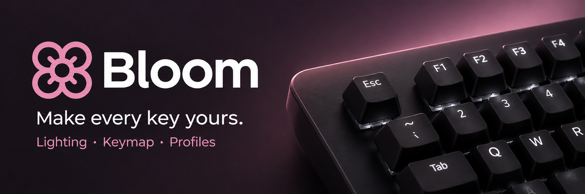

<div align="center">



# Bloom

**Make every key yours.**

[](https://github.com/negimatare/bloom-macos/releases/latest)
[](LICENSE)
[](https://github.com/negimatare/bloom-macos/actions/workflows/unit-tests.yml)
[](https://github.com/negimatare/bloom-macos/actions/workflows/codeql.yml)


</div>

<br>

Bloom is a small macOS app for the Razer BlackWidow Lite. It sets the white
backlight and remaps the keys 1:1. Remaps apply to the Razer only, so your
other keyboards stay as they are. Everything is stored on your Mac, and
nothing is installed system-wide.

---

## What it does

- **Lighting.** Switch the backlight on or off, set the brightness live or
  pick a preset (Night, Soft, Normal, Maximum), and choose a Static or
  Breathing effect. A preview shows the real keyboard.
- **Keymap.** Click a key, then press the key that it should become. When
  another key already gives that function, the two keys swap, so no function
  is lost. The toast offers "Undo" and "Keep both".
- **Profiles.** Keep one profile for each way you work. Edit, duplicate,
  restore to default, delete with "Undo", and export or import as JSON.
- **The background helper.** It applies the active profile again at login
  and after you replug the keyboard. Login Items show it as Bloom MacOS.

---

## Install

Bloom uses [uv](https://docs.astral.sh/uv/) and a project-local `.venv`.

```sh
git clone https://github.com/negimatare/bloom-macos && cd bloom-macos
uv sync
uv run bloom app install      # adds "Bloom MacOS" to ~/Applications
uv run bloom agent install    # applies the remaps again at login and after a replug
```

Open Bloom MacOS from Launchpad or Spotlight, or drag it to the Dock. The app
starts the window from this folder's `.venv`, so you do not need a terminal.

macOS asks for Input Monitoring permission the first time Bloom talks to the
keyboard. Give it to Bloom MacOS, or to the terminal that runs Bloom.

> [!IMPORTANT]
> The app and the helper run Bloom from this folder's `.venv`. Before you
> move or delete the folder, run `uv run bloom app uninstall` and
> `uv run bloom agent uninstall`. After a move, run `uv sync` and the two
> install commands again.

To update, pull the latest release tag, then run `uv sync` and the two
install commands again.

---

## Commands

The window is the main way to use Bloom. The `bloom` command does the same
work from a terminal:

| Command | What it does |
|---|---|
| `uv run bloom-gui` | Open the window |
| `uv run bloom probe` | Find the keyboard and the HID interface that accepts commands |
| `uv run bloom brightness [0..100]` | Show or set the backlight brightness |
| `uv run bloom effect off\|static\|breathing` | Set the backlight effect |
| `uv run bloom keys` | Show the key mappings on the keyboard |
| `uv run bloom map caps_lock escape` | Remap one key |
| `uv run bloom unmap [key]` | Remove one mapping, or all of them |
| `uv run bloom keynames` | List the key names that `map` accepts |
| `uv run bloom apply` | Apply the active profile: lighting and mappings |
| `uv run bloom agent install\|uninstall\|status` | Manage the background helper |
| `uv run bloom app install\|uninstall` | Add or remove Bloom MacOS in `~/Applications` |

---

## Under the hood

<details>
<summary><b>Where Bloom keeps its files</b></summary>

| Path | Contents |
|---|---|
| `~/Library/Application Support/Bloom/` | `config.json` with your profiles, and the helper app |
| `~/Library/Logs/Bloom/` | The log of the background helper |
| `~/Library/LaunchAgents/com.bloom.watch.plist` | The LaunchAgent that starts the helper at login |
| `~/Applications/Bloom MacOS.app` | The app that opens the window |

Key mappings use the macOS `hidutil` tool, for the Razer only. No Karabiner,
no kernel extension and no network request.

</details>

<details>
<summary><b>Structure</b></summary>

```
bloom/          the package
  device.py     finds the keyboard and sends its HID reports
  protocol.py   builds and checks the Razer 90-byte control reports
  lighting.py   brightness and effects
  keymap.py     key mappings through hidutil
  config.py     profiles and config.json
  watcher.py    the background helper and its LaunchAgent
  bundle.py     the small app bundles that macOS shows by name and icon
  cli.py        the bloom command
  gui/          the PySide6 window: controller.py holds the state, the rest are screens and widgets
tests/          pytest, with fakes for the keyboard and hidutil
scripts/        the icon script and the release notes script
docs/readme/    the images of this README
```

</details>

<details>
<summary><b>Development</b></summary>

```sh
uv sync
uv run pytest
```

The tests need no keyboard. A change to the keyboard, `hidutil` or the
background helper also needs a check on a real Razer BlackWidow Lite.
[CONTRIBUTING.md](CONTRIBUTING.md) has the branches and the release steps.

</details>

---

## More

- [CHANGELOG.md](CHANGELOG.md): the changes in each release.
- [CONTRIBUTING.md](CONTRIBUTING.md): the layout, the branches and the release steps.
- [SECURITY.md](SECURITY.md): how to report a vulnerability privately.
- [CODE_OF_CONDUCT.md](CODE_OF_CONDUCT.md): the rules of behaviour for all participants.

---

## Credits

- **Icons**: [Lucide](https://lucide.dev/), under the licence in
  `bloom/gui/LUCIDE-LICENSE.txt`.
- **Lighting protocol**: the report layout follows the
  [OpenRazer](https://openrazer.github.io/) project.
- Razer and BlackWidow are trademarks of Razer Inc. This project has no
  affiliation with Razer.

Released under the [MIT License](LICENSE). Made by
[negimatare](https://github.com/negimatare).
